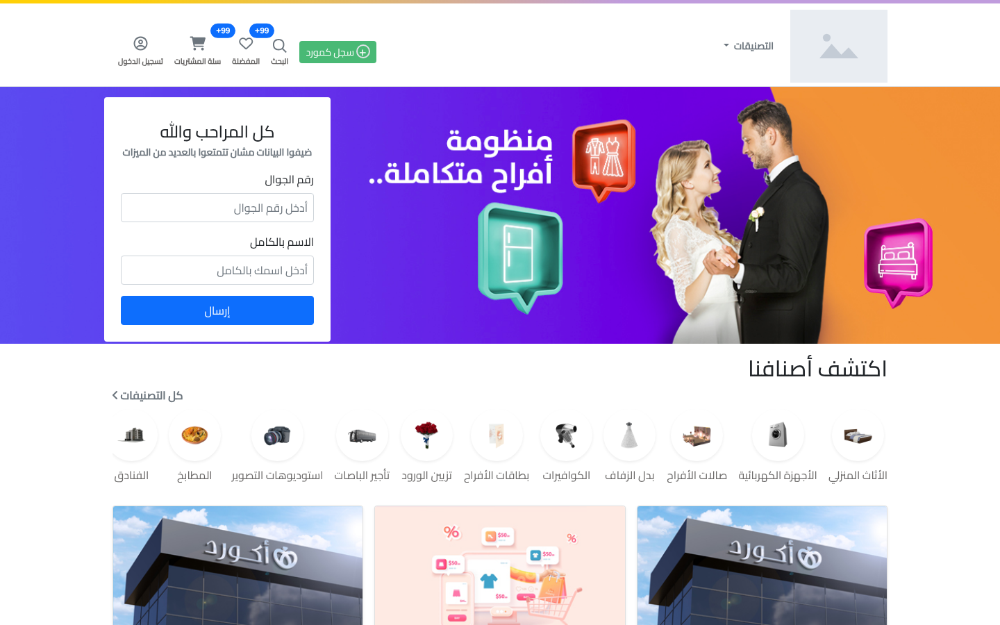
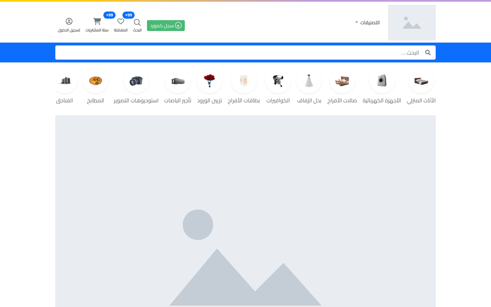
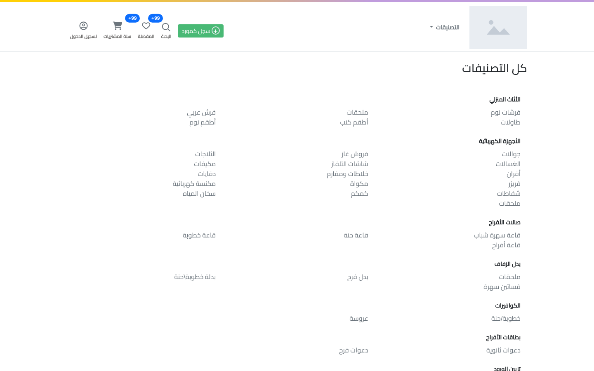

# Sahab: Multi-Vendor Store (Laravel)


A full-stack multi-vendor store platform built with **Laravel 10**, with a static HTML/CSS/JS front end under `Tasks/`.

> **Project status: on hold.** Development was paused because of the ongoing war on Gaza. I plan to resume it when conditions allow.
>
> **حالة المشروع: متوقف مؤقتًا** بسبب الحرب على غزة، وأنوي استكماله عندما تسمح الظروف.

## Screenshots

Captured from the running application. Product images load from an external site, so they are shown as grey placeholders here.



| Search and categories | All categories |
|---|---|
|  |  |

## What exists today

- User registration, login and logout (the profile and change-password pages require a signed-in user)
- Profile update with validation
- Products and categories (models, migrations, product quantity)
- Home, product detail, categories, search and supplier pages
- Cart, wishlist and recycle-bin pages
- Laravel Sanctum installed for token auth

## Planned

- Admin and vendor dashboards
- Vendor and product management
- Reviews and comments
- Responsive, multi-language UI
- Multiple payment gateways (PayPal, Stripe)
- Shipping and order tracking
- Offers and discounts
- Mobile app connected to the platform

## Getting started

### Requirements

- PHP 8.1 or higher
- Composer
- Node.js and npm
- MySQL or MariaDB

### Installation

```bash
git clone https://github.com/MohammedAbd20/sahab-multi-vendor-store.git
cd sahab-multi-vendor-store

composer install
npm install

cp .env.example .env
php artisan key:generate
php artisan migrate
php artisan serve
```

## Credits

The front-end design, Arabic content and visual assets are based on the **accord.ps** website and belong to its owners. This repository builds a Laravel back end around that layout and is not affiliated with Accord.

## Author

**Mohammed Hamdi Abdelrahman**: [GitHub](https://github.com/MohammedAbd20) · [LinkedIn](https://www.linkedin.com/in/mohammed-abdelrahman-web/)
